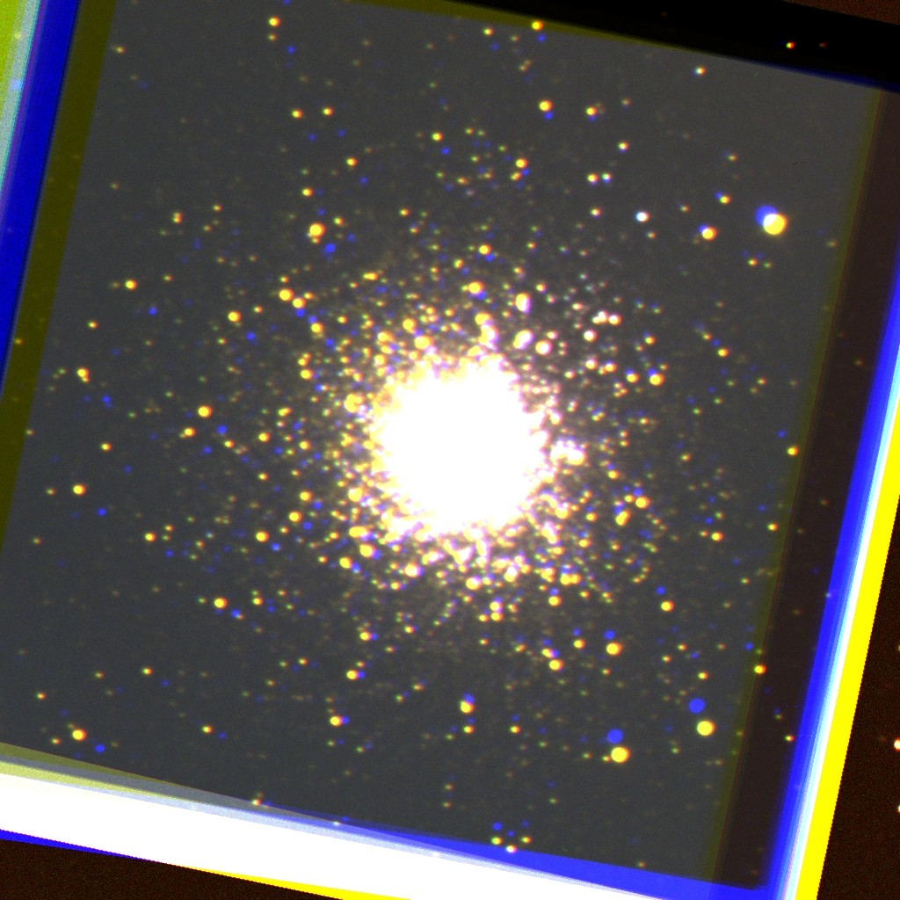
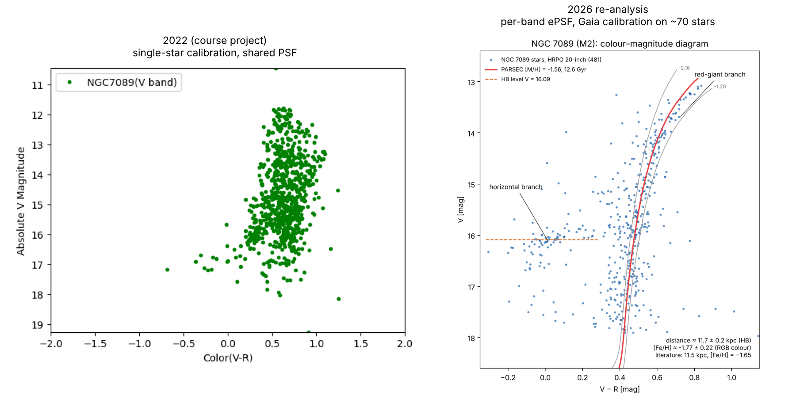

# NGC 7089 (M2): distance and metallicity of a globular cluster from my own telescope images

My final project for ASTR 7361 (Astrophysics Laboratory, Louisiana State University, Fall 2022),
re-analysed in 2026. As PI of the observing proposal, I observed the globular cluster NGC 7089 (M2)
with two classmates using the 20-inch telescope at Highland Road Park Observatory, Baton Rouge
(16 × 60 s exposures in each of V and R). The images were reduced, plate-solved and stacked during
the course. In 2026 I rewrote the photometry, calibration and fitting from scratch; the results
below come from that version.

<p align="center"></p>



## Results

| | This analysis | Literature (Harris 1996, 2010 ed.) |
|---|---|---|
| Horizontal-branch level | V_HB = 16.09 ± 0.02 (63 stars) | 16.05 |
| Distance modulus (m−M)_V | 15.53 | 15.50 |
| Distance | **11.7 ± 0.2 kpc** | 11.5 kpc |
| Metallicity [Fe/H] | **−1.77 ± 0.22** (from RGB colour) | −1.65 |
| Age | not constrained (turn-off at V ≈ 19.3 is fainter than our limit, V ≈ 18) | ~12.5 Gyr |

Errors are statistical plus photometric zero-point only; systematic errors
(horizontal-branch calibration ~0.1 mag, Gaia → V/R transformations ~0.05 mag,
extinction) are larger.

## What changed from 2022

| 2022 version | 2026 version |
|---|---|
| Calibrated with **one** Gaia star | Zero points from **74 (V) and 60 (R)** Gaia stars with sigma clipping; scatter 0.09 / 0.06 mag |
| Bug: the V zero point used the Gaia **R** magnitude | V calibrated against Gaia-derived V |
| V-band photometry reused the **R-band PSF** and R-band positions | Separate effective PSF built from 40 isolated stars in each band |
| Finder assumed FWHM ≈ 4.7 px | Measured seeing FWHM ≈ 7.6 px (4.7″) and used it |
| Axis labelled "absolute magnitude" | Apparent magnitudes, correctly labelled |
| Isochrones matched by eye, by trial and error | Distance from the horizontal-branch standard candle; metallicity from a fit of the RGB colour to PARSEC isochrones |
| "Accepted" distance quoted as 17 kpc | Literature value is 11.5 kpc (Harris 2010) |

## Method

1. **`src/photometry.py`**: subtract a smooth background (`photutils.Background2D`), build an
   effective PSF (ePSF) per band from 40 bright, isolated, unsaturated stars outside the core,
   and run iterative PSF photometry (`IterativePSFPhotometry`). Sky positions come from the
   plate solution in the FITS headers.
2. **`src/calibrate.py`**: match V and R detections (1.5″), match them to Gaia DR2 (a 2′ VizieR
   cone around the cluster), convert Gaia G and BP−RP to Johnson V and Cousins R (Evans et al. 2018),
   and fit a clipped zero point per band using isolated stars more than 1′ from the centre.
   A colour term was checked and is negligible.
3. **`src/isochrone_fit.py`**:
   * **Distance**: the median V of the blue horizontal branch, with
     M_V(HB) = 0.16 [Fe/H] + 0.84 (Harris) and E(B−V) = 0.06.
   * **Metallicity**: with the distance fixed, find the PARSEC isochrone [M/H] whose
     red-giant branch matches the observed median RGB colour, then convert to [Fe/H] for
     an α-enhanced cluster ([Fe/H] = [M/H] − 0.21, Salaris et al. 1993).
   * **Uncertainties**: 1000 bootstrap resamplings of the stars, with random zero-point shifts.
4. **`src/make_comparison.py`**: the 2022 vs 2026 figure.

## Repository layout

```
m2-globular-cluster-cmd/
├── run_all.sh                 # runs the whole analysis (~30 s)
├── requirements.txt
├── src/                       # analysis code
│   ├── config.py              # paths
│   ├── photometry.py          # background, ePSF, PSF photometry
│   ├── calibrate.py           # Gaia cross-match and zero points
│   ├── isochrone_fit.py       # HB distance, RGB metallicity, CMD figure
│   └── make_comparison.py     # 2022 vs 2026 figure
├── data/
│   ├── light_NGC7089_V.fit    # stacked, reduced, plate-solved images (HRPO 20-inch, 16 × 60 s)
│   ├── light_NGC7089_R.fit
│   ├── gaia_dr2_ngc7089_2arcmin.tsv   # Gaia DR2 cone (VizieR I/345/gaia2)
│   └── isochrones/            # PARSEC isochrones, log age = 10.10, [M/H] = −2.16 … −1.20
├── results/                   # outputs: catalogues (CSV), fit results (JSON), figures
├── course_2022/               # original 2022 report, proposal, slides, notebooks and figures
└── tools/trim_isochrones.py   # how the isochrone files were cut down from the full PARSEC tables
```

## Running it

From the root of this repository:

```bash
cd m2-globular-cluster-cmd
pip install -r requirements.txt
bash run_all.sh
```

Outputs are written to `results/`. Set `M2_DATA=/path/to/data` to use a different data folder.

## Limitations and next steps

* The photometry stops at V ≈ 18, so the main-sequence turn-off (and therefore the age) is
  out of reach. Longer exposures, or a fainter-limit catalogue, would allow an age measurement.
* The crowded core (inner ~0.8′) is excluded; the 4.7″ seeing blends stars there.
* The Gaia cone used for calibration only covers the inner 2′. A larger Gaia DR3 query
  would give more calibration stars across the whole field.
* V − R is only weakly sensitive to metallicity; a B − V CMD would constrain [Fe/H] better.
  (A B-band stack exists, but its plate solution needs checking first.)

## The 2022 version

`course_2022/` keeps the original report, observing proposal, slides, notebooks and figures
exactly as submitted. They contain the problems listed under *What changed from 2022*.

## Credits

Course: ASTR 7361, Louisiana State University, Fall 2022, taught by Dr. Matthew Penny.
Observations with co-investigators Riley Dawkins and Sachin Mohandas.
Image reduction, plate solving and stacking used the course's `hrpo-pipeline` (Dr. Penny).
Isochrones: PARSEC (Bressan et al. 2012). Calibration stars: Gaia DR2 (Gaia Collaboration 2018).
